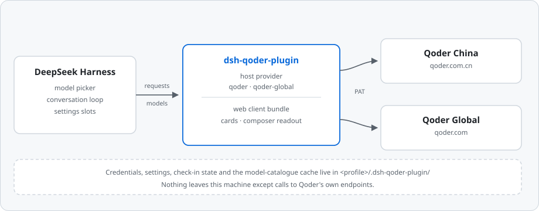
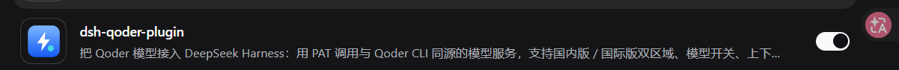
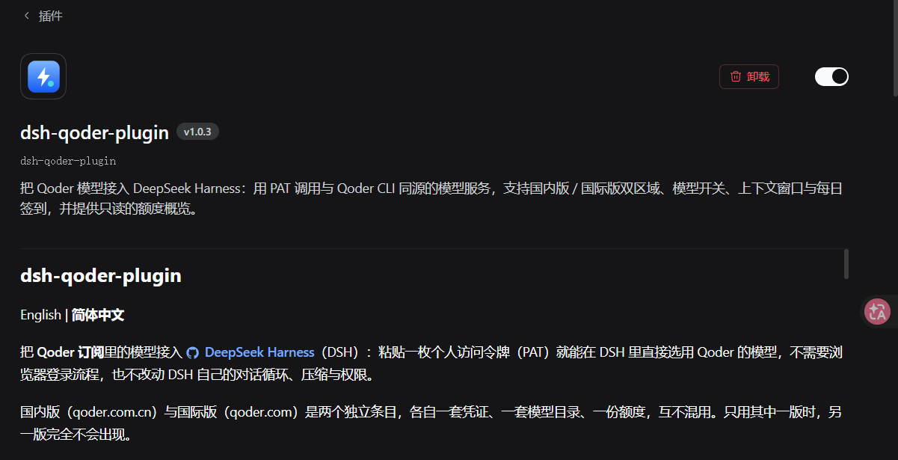
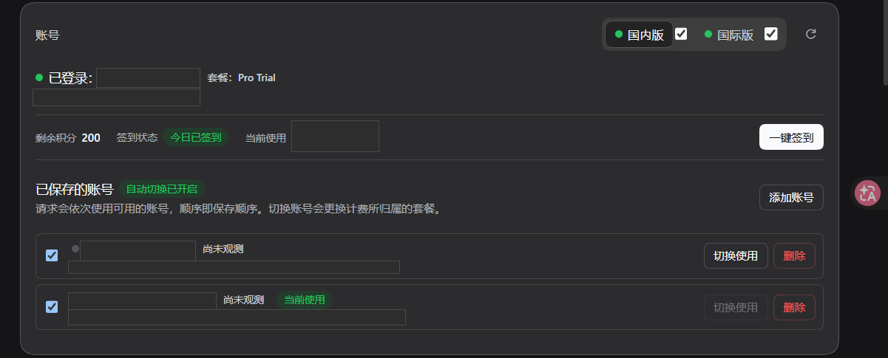
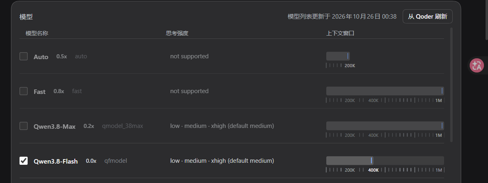
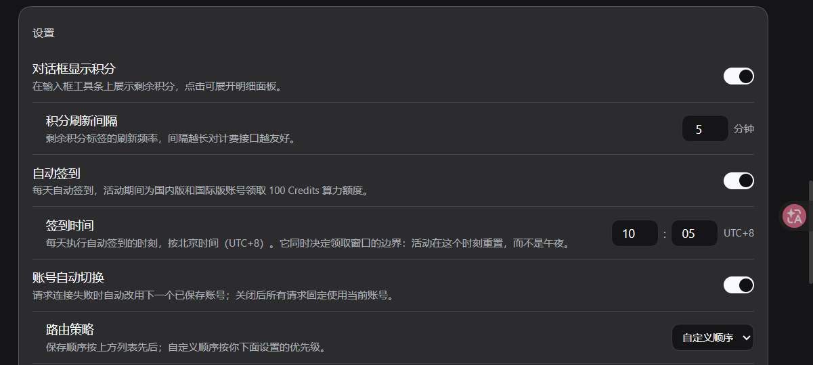

# dsh-qoder-plugin

[English](./README.en.md) | **简体中文**

把 **Qoder 订阅**里的模型接入 [DeepSeek Harness](https://github.com/deepseek-ai/deepseek-harness)（DSH）：粘贴一枚个人访问令牌（PAT）就能在 DSH 里直接选用 Qoder 的模型，不需要浏览器登录流程，也不改动 DSH 自己的对话循环、压缩与权限。

国内版（qoder.com.cn）与国际版（qoder.com）是两个独立条目，各自一套凭证、一套模型目录、一份额度，互不混用。只用其中一版时，另一版完全不会出现。



## 能做什么

- **粘贴即用**：在设置卡上粘贴 PAT 点「保存」，插件先向对应区域校验令牌，通过才落盘，模型随即出现在 DSH 的模型选择器里，无需重启。之后可随时「更换 PAT」或「清除 PAT」；新令牌校验通过才会覆盖旧的，粘贴打错不会把可用凭证弄丢。
- **双区域独立**：`qoder`（国内版）与 `qoder-global`（国际版）各有自己的凭证与模型目录。qoder.com 生成的令牌对中国区无效，反之亦然，两套不会互串。
- **模型开关**：按 Qoder 官方顺序逐行列出该版本的全部模型（不重排），每行标出推理档位与官方默认档位；关掉的模型会立刻从 DSH 的模型选择器里隐藏。
- **上下文窗口逐模型选择**：每个模型一行粗实心滑块，下方标出该模型声明过的窗口刻度；拖动只改草稿，松手吸附到最近的可用档位，改动与其他设置一起「保存」时提交。
- **模型目录三级降级**：优先实时拉取；断网或重启时回退到上次保存的目录；再不行用内置名单兜底。卡片上写明当前列表来自哪里，并可就地手动刷新。
- **输入框额度读数**：当前会话选用 Qoder 模型时，输入框工具条上出现 `Qoder · 剩余额度`；点开是一枚锚定的小面板，套餐、剩余 / 总量、进度与到期时间一屏看完。切到别的模型它自动让位。
- **每日签到**：每天可领 100 Credits。领取窗口是 **10:00 → 次日 10:00（UTC+8）**，不是自然日——夜里 23 点领完，凌晨仍是「今日已签到」。账号卡片上直接显示签到状态与剩余积分，可一键领取，也可在设置里开启自动签到（默认关闭），并统一设置签到时刻。
- **多账号**：同一版本可保存多个 PAT 并随时切换，每个账号的剩余积分与状态都直接显示在列表里。默认开启的自动切换会在某个账号连不通时按保存顺序换到下一个可用账号；这些选项都在「设置 / 高级设置」里，默认值即可用，不需要调整。
- **上游排队时说清楚**：上游暂时不服务某个模型时，对话里会出现一段说明而不是一串报错——写清这不是登录态或额度问题、上游建议多久后重试、原文是什么，并在下一次对话被接受后自动失效。
- **倍率标注**：模型名后直接显示 Qoder 报价的倍率（如 `x0.79`，免费为 `x0.0`），仅作展示，不影响请求。

## 界面

截图取自中文深色界面；账号卡片里的账号名、余额与令牌尾号已打码。











## 安装

前置条件：

- DSH **≥ 0.1.7**（设置卡片依赖 0.1.7 起的插件配置槽位），上限 `< 0.3.0`；
- Node.js `^22.19.0 || >=24.0.0`；
- 一个 Qoder 账号，以及至少一枚个人访问令牌。

```sh
dsh plugin --profile web add dsh-qoder-plugin
```

按你使用的 profile 换 `--profile` 的值（`web` / `desktop` / `tui`）。装到哪个 profile，数据就落在哪个 profile 目录里，各自独立。

也可以从 GitHub 安装，把仓库地址交给同一条命令：`dsh plugin --profile web add github:<用户名>/dsh-qoder-plugin`。

> **DSH 版本**：0.1.5 / 0.1.6 上宿主功能（模型、PAT、目录、签到）照常可用，但**设置卡片不会出现**——那两个版本还没有插件配置槽位。区间以 `peerDependencies` 声明，这也是 DSH 安装时实际校验的字段。

> **从旧版本升级**：本插件曾用名 `dsh-connect-qoder-x`，0.6.0 起 profile 行 id 改为 `qoder-plugin`。重新执行上面的安装命令即可，数据目录原地不动；若插件管理器里出现了新的「配置」入口，点一次即可。

## 配置

### 生成 PAT

- **国内版**：登录 [qoder.com.cn](https://qoder.com.cn) → 账号设置 → 个人访问令牌，生成后复制。
- **国际版**：登录 [qoder.com](https://qoder.com) → 账号设置 → 个人访问令牌，生成后复制。

### 保存到卡片

打开设置界面（见下一节），把 PAT 粘进密码输入框点「保存」。插件会先向对应区域校验令牌，通过才写盘。两类失败分开提示：令牌被 Qoder 明确拒绝，还是**连不上 Qoder**——网络问题不会把可用令牌说成坏令牌。

### 环境变量兜底

不方便用卡片的场景，在**没有保存过凭证文件**时插件读取环境变量：

| 变体 | 环境变量 |
|---|---|
| `qoder`（国内版） | `QODER_CN_PERSONAL_ACCESS_TOKEN` |
| `qoder-global`（国际版） | `QODER_PERSONAL_ACCESS_TOKEN` |

文件优先于环境变量：该变体保存过有效凭证后，环境变量不再生效。

## 命令行（可选）

不开图形界面也能完成同样的配置：

```sh
dsh-qoder-plugin status            # 凭证状态与剩余积分
dsh-qoder-plugin pat set <PAT>     # 校验并保存令牌
dsh-qoder-plugin pat clear         # 删除已保存的令牌（logout 同义）
dsh-qoder-plugin catalog refresh   # 重新拉取模型目录并保存
dsh-qoder-plugin doctor            # 不含敏感信息的环境自检
```

`--provider` 指定操作哪个版本（`qoder` / `qoder-global`，默认 `qoder`）；`status` 与 `doctor` 支持 `--json` 输出；`pat set` 也可以用 `--file <路径>` 或 `-`（标准输入）读令牌，免得写进 shell 历史。设置卡片不出现的 DSH 版本上，这是唯一的配置方式。

## 在哪里找到设置界面

DSH 0.1.7 起插件配置统一收进「插件」页：打开**「插件」**页，在已安装列表里找到本插件点开，设置正文直接内联在包描述下方。找不到时别去「设置」里翻——那里没有本插件的入口。

四张卡自上而下：

1. **账号**：国内版 / 国际版切换、登录状态、套餐、剩余积分与签到、保存的账号列表（切换 / 删除 / 暂不使用）；
2. **模型**：模型目录来源与刷新、逐模型开关、上下文窗口；
3. **设置**：在对话框显示积分、积分刷新间隔、自动签到与签到时间、账号自动切换与顺序；
4. **高级设置**（默认收起）：排队重试、会话粘性、设备码重置。关着时卡里的行不显示，各项按已保存的值生效，打开才改得动。

卡片本身不自绘外壳，主题、配色与按钮形态都由 DSH 提供；深色主题与键盘焦点跟随宿主，插件不自带配色。

## 数据与隐私

- 插件的全部自有文件收在 `<profile>/.dsh-qoder-plugin/`：凭证、设置、签到状态，以及可重建的模型目录缓存（`state/` 子目录）。
- 环境变量 `DSH_QODER_DATA_DIR` 可显式覆盖数据目录。
- 凭证只存在本机，除发往 Qoder 自己的接口外不会发往任何地方；插件没有遥测，不收集使用数据，也不读取你的对话内容做统计。
- 删掉这个目录等于清空本插件的全部本地状态（已保存的账号也会一起消失）。

## 常见问题

**卡片显示「未登录」**：该变体还没有可用凭证。粘贴 PAT 保存，或设置对应的环境变量。国内版与国际版是两套凭证，给国际版填了不会让国内版亮起来。

**对话里出现「上游模型暂不可用」**：不是你的登录态或额度出了问题，是上游此刻不服务这个模型。说明里会写清上游建议的重试时间与原文，下一次对话被接受后自动失效。

**账号被标成「排队」或「限流」**：收到上游排队回应记为排队；连续几次连接失败升级为限流；随后一次成功的对话会把它清回正常。标签只影响你对账号的判断，不会自动删除账号。

**一键签到报「被 Qoder 以冲突拒绝」**：上游用 409 拒绝领取（本轮已经领过，或当前窗口不可领）。插件会重新读一次活动列表再作答，明确告诉你这次有没有拿到 Credits。

**模型列表为空或明显偏少**：卡片顶部会写明当前列表来自「实时拉取 / 已保存目录 / 内置兜底」，可就地刷新。整版被关闭、或所有模型都被关掉时，模型选择器里自然看不到该版本。

**保存设置没有反应**：控件只接受落在允许区间内的值，越界的输入不会写入；数字框失焦即提交，提交被拒会退回已保存的值。

**国际版签到提示「需要本机安装 Qoder 客户端」**：国际服务只对本机已安装 Qoder 桌面客户端的设备下发该活动，装上客户端即可；国内版没有这个要求。

## 开发

```sh
pnpm install
pnpm run build      # tsdown 产出 lib/（宿主 bundle + client bundle）
pnpm test           # vitest run
pnpm run test:qoder # node --test（Qoder 传输层用例）
pnpm run typecheck  # tsc：宿主 + client 两份 tsconfig
pnpm run check      # typecheck + test + test:qoder + build
```

仓库结构与架构说明见 [docs/architecture.md](./docs/architecture.md)，构建、测试基线与发版流程见 [docs/development.md](./docs/development.md)。更新日志在 [CHANGELOG.md](./CHANGELOG.md)。

## 致谢

本项目的实现参考了以下开源项目，在此致谢：

- [dsh-qoder-connect](https://github.com/masknull/dsh-qoder-connect) — 插件骨架与 connect 机制
- [dsh-connect-workbuddy](https://github.com/masknull/dsh-workbuddy-connect) — 设置卡片与输入框读数的形态
- [dsh-provider-qoder](https://github.com/mo-n/dsh-provider-qoder) — Qoder 传输层协议细节

以上项目均以 MIT 许可发布；本项目同样按 [MIT](./LICENSE) 发布，见 [NOTICE](./NOTICE)。本项目与 Qoder、DeepSeek 官方均无关联，是社区适配器。

## 免责声明

- Qoder 的接口由其服务端提供、可能随时变动，可能改动、限流或封禁调用方，导致本插件部分或全部功能失效，不保证兼容窗口。
- 本工具仅供个人学习研究，用于驱动**使用者自己的** Qoder 账号；请勿用于商业转售或任何超出个人合理使用的场景。使用即表示你自行承担账号被限制、额度损失、服务中断等一切后果，并遵守 Qoder 的服务条款。
- 作者不对因使用或滥用本插件产生的任何直接或间接损失负责。文中出现的 Qoder、DeepSeek 等名称与商标归各自权利人所有，仅作兼容性描述之用。
