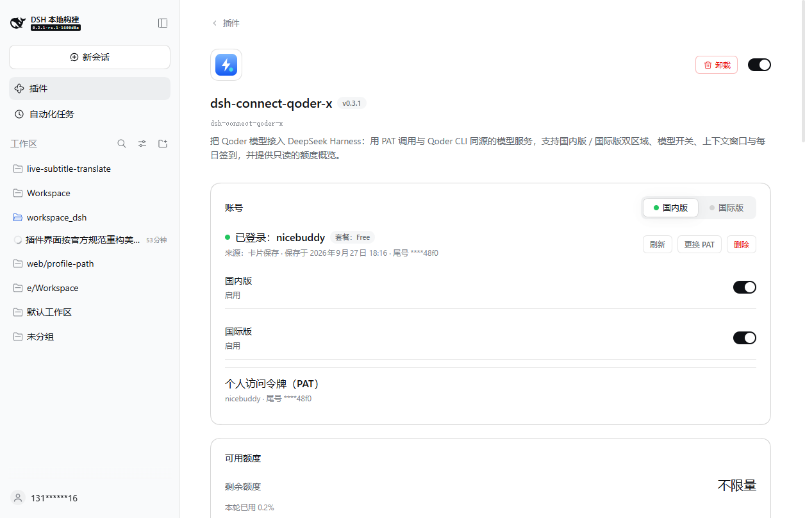
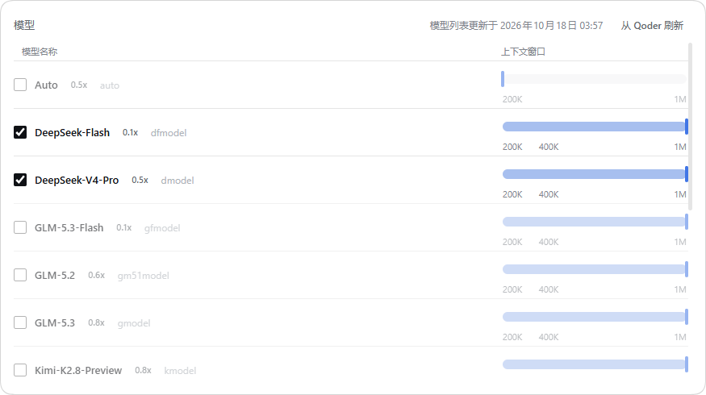
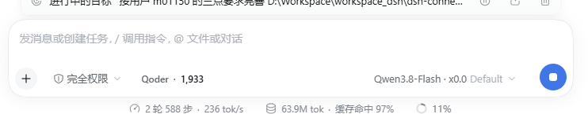
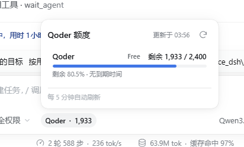

# dsh-qoder-plugin

[English](./README.en.md) | **简体中文**

把 **Qoder 订阅**的模型以个人访问令牌（PAT）接入 [DeepSeek Harness](https://github.com/deepseek-ai/deepseek-harness)（DSH）的社区插件。

更新日志见 [CHANGELOG.md](./CHANGELOG.md)（英文）。

一个插件同时服务两条 Qoder 产品线，各自一套凭证、一个 provider、一份模型目录，互不混用：

| 变体 | provider id | PAT 生成站点 |
|---|---|---|
| 国内版 | `qoder` | qoder.com.cn |
| 国际版 | `qoder-global` | qoder.com |

只需要哪一版就只配哪一版：未保存 PAT 的变体不显示模型分组，另一版完全不受影响。流式输出、推理内容、工具调用走插件内置的 Qoder 传输层；对话循环、压缩与权限始终由 DSH 本体掌控。

---

## 这个仓库是什么

`dsh-qoder-plugin` 是 [DeepSeek Harness](https://github.com/deepseek-ai/deepseek-harness)（DSH）的社区插件：用个人访问令牌（PAT）把 Qoder 的模型接入 DSH，国内版与国际版各自一套凭证、provider 与模型目录，互不混用。

**本插件的标识**（安装、排障、看数据目录时会用到）：

| 项 | 值 |
|---|---|
| 包名 | `dsh-qoder-plugin` |
| profile 行 id | `qoder-plugin` |
| 数据目录 | `<profile>/.dsh-qoder-plugin/` |
| HTTP 路由前缀 | `/plugins/dsh-qoder-plugin/*` |
| CLI 命令 | `dsh-qoder-plugin` |

**为什么行 id 与包名不一致**：DSH 的插件配置槽 key 是 `` `${包名}#${行id}` ``，包名来自 `package.json`、行 id 来自插件 patch 声明的 `id`。两者都写全名，是为了让这个 key 在任何 profile 里都唯一、不与其它 Qoder 插件相撞。详见[设置界面与 DSH 版本](#设置界面与-dsh-版本)。

---

## 功能

- **PAT 即存即用**：在设置卡片上粘贴 PAT 点「保存」，插件先对该变体的区域实时校验，通过才落盘，模型分组立即出现，无需重启 DSH。已登录后可「更换 PAT」（新令牌校验通过才覆盖，粘贴打错不会把可用凭据弄丢）与「清除 PAT」。
- **双变体独立配置**：`qoder`（china）与 `qoder-global`（global）各有自己的凭证文件、路由与已保存目录——qoder.com 生成的令牌对中国区无效，反之亦然，两套永不互串。
- **账号池与自动切换**：同一版本可以存多个 PAT，卡片上逐行列出（顺序号、令牌尾号、账号名、模型套餐、剩余积分），点一下即切换，也可以删除。失败后自动换号**默认开启**：一次请求在任一账号上连不通（网络中断、超时、首字节之前断流、上游 5xx、限流）就按顺序换下一个账号重试，整池最多走一遍——**一个文件走到末尾会续到另一个版本的文件**，所以混排的账号真的会被轮到，且每个账号始终用**它自己所属区域**的端点签名（国内号走国内网关、国际号走国际网关，不会拿错端点必失败）；拒绝类错误（请求本身不合法）和「模型排队」不换号——前者换谁都一样，后者是模型的事实、不是账号的问题。「设置」里可以关掉自动切换（关掉后路由策略与自定义顺序也一并收起并停止生效）；**排队重试**总开关在「高级设置」里（默认收起），决定要不要等排队、开启后再调**排队等待次数 / 排队等待秒数**（上游说排队时先在这次请求内等一等，最多等几次、每次最多等几秒）、调整**路由策略**（按保存顺序，或自己拖一个跨版本混排的固定顺序——自定义顺序是一份**优先级**：新会话从列表里第一个可用账号开始，失败和粘性换号再按它往下走；混排时会列出「只在一个版本启用的模型」作为说明，不拦保存），以及同在「高级设置」里的**会话粘性**（同一会话由一个账号服务，达到**轮数 / 请求次数 / 分钟**任一条限制就**自动换到顺序里的下一个账号**——轮数按「一次对话的模型输出完整结束」计 1 轮，默认 3 轮 / 200 次请求 / 180 分钟，三项各自填 0 即关闭该项）。
- **账号勾选与健康状态**：每个账号行前有勾选框，取消勾选即「暂不使用」——不删号、不丢令牌，只是不再参与任何路由与自动切换，输入框面板里它的积分显示为「已暂停使用」而不是可用余额。每行还带一个健康标签：**正常 / 排队 / 限流**。收到「模型排队」记为排队；连续 3 次连接失败升级为限流——排队本身不会升级（它只说明上游此刻拥挤，不代表账号被限流）；一次成功的对话会把它清回正常。
- **每账号设备码 + 一键重置**：每个账号发给上游的设备指纹由「账号身份 + 本机种子」推导——同一账号在同一台机器上保持稳定（不会每次请求都变成新设备），两个账号之间互不相同（不会共用一台「设备」）。设置卡最下面多了一张**设备码**卡：点一下「重置设备码」就给所有已保存账号换一套新指纹，不删 PAT、不退出登录、也不动本机真实的 machine id，只是让每个账号的下一次请求以新设备身份重新注册。种子文件在 `~/.dsh/qoder/device_seed`，删掉它等同于从未重置过（回到历史指纹）。
- **模型目录三级降级（live → saved → fallback）**：卡片明示当前列表来自哪里——「模型列表更新于 …」（实时拉取）、「当前显示已保存的模型列表，更新于 …」（本账号上次成功目录，重启或断网后顶上来）、「当前显示内置模型列表（尚未从 Qoder 更新）」（编译进插件的兜底名单）；最近一次拉取失败时附带原因，并可在卡片上手动「刷新模型列表」。
- **上下文窗口逐模型切换（暂存后统一保存）**：模型卡片的每一行带一根 Qoder 同款的粗实心滑块（下方标注该模型声明过的窗口刻度：200K / 400K / 1M），拖动是连续无极的，松手时才吸附到最近的可用档位；拖动只改本地草稿，不再拖一下写一次；开关与窗口改动一起交给「保存设置」一次提交，未保存时卡片底部出现「未保存 N 项」保存栏，取消即还原。发送请求时按所选档位带上窗口值；未声明窗口的行退回插件内置的保守默认值（180K）；两版的选择独立保存、互不影响。
- **模型自由开关**：插件页的「模型」卡片按 Qoder 官方模型列表的顺序逐行列出该变体的全部模型（不重排，与官方 GUI 一致），每行标出该模型的推理档位与官方默认档位；可单独开启或关闭，关闭的模型会立刻从 DSH 的模型选择器中隐藏。规格来自 Qoder 目录，未声明的条目不会凭空出现。
- **上游不可用时的说明，而不是一个报错**：上游说「模型排队 / 暂不可服务」时，插件在对话里插入一段说明（沿用插件已有的 `command/run` + `command/done` 提示行机制，参考 dsh-connect-workbuddy 的做法），写清这不是登录态或额度问题、上游建议多少秒后重试、原文是什么，并在同一个故障窗口内重复出现时提示「可能已被风控」。上面那句「已按上游建议等待 30 秒仍不可服务」只在**确实等过**时才出现——这次请求真的按上游建议等满了一个窗口、之后仍被拒绝，才会这么写；等的时间不够就只报事实。同样的话一轮对话里只插一次，不叠行；下一次对话被接受后这条说明即失效，不会一直挂在界面上。
- **每日签到（自动 + 手动）**：每天可领取 100 Credits。领取窗口是 **10:00 → 次日 10:00（UTC+8）**，不是自然日——插件全程按「窗口」判断本轮是否已领：夜里 23 点领完，凌晨打开卡片仍是「今日已签到」，到次日 10:00 才重新变为「立即领取」。自动签到**默认关闭**，在「设置」里开启；签到时间由**一个**「签到时间」统一控制国内版与国际版（默认 10:00，自定义时刻会同步移动两版的窗口边界），开启后开机自动补签防漏。账号卡片上直接显示「剩余积分 / 签到状态 / 当前使用」，并有一颗**一键签到**按钮一次领取两版。**国际版要求本机已安装 Qoder 桌面客户端**：国际服务只对携带客户端生成的设备风控身份的请求下发该活动，未安装时插件会明确提示「需要本机安装 Qoder 客户端」而不是误报「今日无活动」。国内版无此要求。
- **输入框额度读数 + 额度面板**：输入框工具条上常驻一枚 `Qoder · 剩余额度` 读数，**只在当前会话选用 Qoder 模型时出现**（切到别的模型立即让位，不占工具栏）。点击在读数上方展开一枚紧凑面板：只显示当前模型所属版本的那一行，含套餐标签、剩余 / 总量、实心进度条、百分比与到期时间，底部注明自动刷新间隔，面板里可手动刷新；数值按账号实际持有的资源包合计（`credits.unlimited` 不再遮掩真实剩余）。侧栏小卡与中间额度面板已取消，额度只在「用得到的地方」出现。读数本身在「设置」最上方用**一个**「在对话框显示积分」开关收起或打开（作为本机浏览器偏好保存，不写插件设置文件）。
- **倍率显示 `x<priceFactor>`**：模型名后直接拼 Qoder 报价的价格倍率（模型选择器里显示为 `某模型 · x0.79`，免费为 `x0.0`），来自目录接口的 `price_factor` 字段，仅作展示、不影响请求；Qoder 未报倍率的模型不显示后缀，不会凭空补一个数。整数倍率统一补一位小数（`x1.0`），非整数倍率按 Qoder 原值显示（`x0.79`、`x1.6`）。卡片内的模型列表把同一数字写成 `0.5x` 的形式，两处数值一致、只是排版方向不同。

---

## 界面速览

设置页由四张卡自上而下组成：**账号**（登录状态、套餐、剩余积分 / 签到状态 / 一键签到、版本切换与整版开关、凭证来源、更换/清除 PAT、**多账号列表**——每行勾选框 + 切换 + 删除 + 健康标签）、**模型**（目录来源与刷新、逐模型开关、上下文窗口滑块、统一保存）、**设置**（在对话框显示积分、积分刷新间隔、**自动签到与签到时间**、**自动切换开关**、**路由策略与顺序**），以及**高级设置**（默认关闭：**排队重试开关与次数 / 秒数**、**会话粘性开关与轮数 / 请求次数 / 分钟**、**设备码**一键重置）。「高级设置」由卡头的一枚开关控制，**默认关闭**：关着时卡里的行不显示，各项按已保存的值生效（没改过就是默认值），打开才显示并改得动——日常用得上的都在「设置」里，开关只是把需要调优的那几项收起来。从属关系是显式的：**路由策略与自定义优先级只在「账号自动切换」开启时出现**，**签到时间只在自动签到开启时出现**，**积分刷新间隔只在「在对话框显示积分」开启时出现**，**排队重试次数 / 秒数只在「排队重试」开启时出现**，**粘性三项只在会话粘性开启时出现**——关掉总开关时，从属的控件与功能一起关闭，不会留下一个「设了却不起作用」的数字。**会话粘性**不挂在自动切换下面（它挪进了「高级设置」），所以自动切换关闭时它照样显示，但卡片会直接写明「仅在账号自动切换开启时生效」。额度展示已移到输入框读数与账号卡片的摘要行，页面不再堆叠空卡片。账号列表与「自定义优先级」列表里，每个账号名后都直接显示该账号的**剩余积分**与**健康状态**（正常 / 排队 / 限流），不用点开也能看出哪一个还能用。所有数值来自 Qoder 接口，未声明的条目不凭空出现。

账号卡片顶部是**国内版 / 国际版**分段切换，每个页签右侧的方框用来整版启用或关闭该版本的全部模型；下方摘要行给出当前账号的剩余积分、今日签到状态与「当前使用」，右侧是「一键签到」：



「模型」卡片按 Qoder 官方顺序逐行开关模型并标出推理档位，滑块选择该模型的上下文窗口（拖到哪算哪，松手吸附到最近的可用档位）；改动先暂存，点「保存」一次提交，关闭的模型会从 DSH 的模型选择器中消失：



输入框工具条上的额度读数（仅当会话选用 Qoder 模型时出现），点开是锚定在读数上方的小面板，两版额度、套餐与到期时间一屏看完：





---

## 在哪里找到设置界面

DSH 0.1.7 起把插件配置统一收进**「插件」页**（0.2.x 沿用同一套槽位）。装好后它出现在「插件」页的**「已安装」**分组里：


点它进入包详情页，设置正文**直接内联**在包描述下方——这就是本插件的设置界面：


卡片本身不自绘外壳（标题、图标、面包屑、版本与开关都由「插件」页绘制），只渲染配置正文：四张设置卡自上而下排列——账号、模型、设置，以及一张默认关闭的**高级设置**卡。没有二级页签，也没有自绘的折叠外壳；高级设置卡的那枚开关决定卡里的行画不画（关闭时它们不渲染，各项按已保存的值生效），而不是把已画出的东西藏起来。深色主题、紧凑侧栏与键盘焦点均由 DSH 主题令牌接管，插件不自带配色；按钮也沿用宿主的三种官方形态——保存是实心主按钮（浅色主题近黑、深色主题近白），清除凭证是官方「卸载」同款描边危险按钮（不带垃圾桶图标，以便与真正的卸载区分），其余操作是无框白字按钮。

> **找不到设置入口时**：本插件的卡片只出现在「插件」页。若你在「设置」里翻找过，那里没有本插件的入口——插件配置自 DSH 0.1.7 起统一收归「插件」页。

---

## 安装

前置条件：

- DSH 核心 **`>=0.1.7-rc.1 <0.3.0`**（0.1.7 与 0.2.x 均可；区间以 `peerDependencies` 声明，这是 DSH 安装时**实际校验**的字段——`app-boot` 的兼容性预检只读 peer 依赖，不读 `engines.dsh`）；
- Node.js `^22.19.0 || >=24.0.0`（`package.json` engines）；
- 你自己的 Qoder 账号，以及至少一枚个人访问令牌。

> **DSH 版本支持范围**
>
> 本插件注册在 DSH 0.1.7 起的**插件配置槽位**上，因此**要求 DSH ≥ 0.1.7**：
> 在 **0.1.5 / 0.1.6** 上宿主功能（模型、PAT、目录、签到）照常可用，
> 但**设置卡片不会出现**（那两个版本没有 `plugins.row.config` 槽）。
>
> 上限为 `<0.3.0`：已核对 `dsh-v0.1.7-rc.2` → `dsh-v0.2.0-rc.1` 两个 tag，
> 本插件所依赖的全部 9 个包**零源文件变更**，故 0.2.x 无需改动即可运行。
> 区间写在 `peerDependencies`——DSH 安装时校验的就是这个字段。

```sh
# 从 GitHub 安装
dsh plugin --profile web add github:road-kid/dsh-qoder-plugin
```

按你使用的 profile 换 `--profile` 的值（`web` / `desktop` / `tui`）。装到哪个 profile，数据就落在哪个 profile 目录里，各自独立。

> **与其它 Qoder 插件共存**：本插件的包名、行 id、路由前缀与数据目录都是独立命名，因此可以与其它 Qoder 插件同时安装、配置互不干扰。（同一个插件装两次则不行——profile 里同名的行只应存在一个。）

> **从 0.4.x 升级**：本插件已从 `dsh-connect-qoder-x` 更名为 `dsh-qoder-plugin`
> （包名、模块 id、路由前缀、数据目录与仓库名一起改）。**0.6.0 起 profile 行 id 也
> 从 `llm-qoder-x` 改为 `qoder-plugin`**，重装后请在插件管理器里重新点一次「配置」，
> provider（`qoder` / `qoder-global`）与已选模型不受影响。重新执行上面的安装命令即可，
> 数据目录 `<profile>/.dsh-qoder-plugin/` 原地不动。


### 分发与市场收录

- **从 GitHub 安装**（见上，推荐）：仓库里带着构建好的 `lib/`，直接取源码即可用，不需要额外的构建脚本许可。
- **从 npm 安装**：`dsh plugin --profile web add dsh-qoder-plugin` 会拿到预构建产物，同样不需要构建许可（参见 DSH 的[插件发布指南](https://github.com/deepseek-ai/deepseek-harness/blob/main/docs/user/develop/basic/publish.md)）。npm 上的包与 GitHub 上的 `v*` 标签同源同版本，`pnpm add dsh-qoder-plugin@<version>` 可锁定到某个历史版本。
- **在「发现」里搜不到名字？** DSH 的插件市场按配置的**市场索引**（`index.json`）检索，并不直接搜索 npm：只发布 npm、但包未被任何索引收录时，市场里仍然搜不到。想让它可被搜索，需要发布到 npm 后用 DSH 自带的 `plugin-market-generator` 生成索引，或把自建索引的 URL 添加进「自定义插件市场」。

---

## 配置与使用

### 生成 PAT

- **Qoder（国内版）**：登录 qoder.com.cn → 账号设置 → 个人访问令牌，生成后复制。[直达获取](https://qoder.cn/account/integrations)
- **Qoder Global（国际版）**：登录 qoder.com → 账号设置 → 个人访问令牌，生成后复制。[直达获取](https://qoder.com/account/integrations)

### 在卡片上保存

按上一节的路径打开设置界面，把 PAT 粘贴进密码输入框，点「保存」（期间显示「校验并保存中…」）。保存动作会先经 Qoder 校验令牌对该变体的区域有效，失败则不落盘。**两类失败分别提示**：Qoder 明确拒绝 → 「PAT 无效或已过期 — 请到账号设置重新生成后再试。」；连不上 Qoder（超时/网络/5xx）→ 「无法连接 Qoder 校验该 PAT（…）。令牌未保存 — 请检查网络后重试。」——网络问题不会把可用令牌说成坏令牌。两版各填各的卡片即可两组并存。

### 环境变量兜底

不方便走卡片的场景可用环境变量：**未保存过凭证文件**时插件读取 env 兜底——

| 变体 | 环境变量 |
|---|---|
| `qoder`（china） | `QODER_CN_PERSONAL_ACCESS_TOKEN` |
| `qoder-global` | `QODER_PERSONAL_ACCESS_TOKEN` |

优先级为 **文件 > env**：只要该变体保存过有效的凭证文件，环境变量就不再生效。

---

## 数据与隐私

插件的全部自有文件收在数据目录一处：`<profile>/.dsh-qoder-plugin/`（凭据在根，可重建的缓存在 `state/` 子目录）：

```text
<profile>/.dsh-qoder-plugin/
├── .qoder-auth.json              # 中国版账号池（{version:3, activeId, accounts:[{id, pat, region, savedAt, enabled?}]}）
├── .qoder-global-auth.json       # 国际版账号池（同上结构，两版互不相通）
├── settings.json                 # 刷新间隔 / 签到时间 / 整版开关等自有配置
├── checkin-status.json           # 签到状态（今日是否已领/领取时刻），不含台账
└── state/
    ├── .qoder-catalog.json       # 中国版按账号保存的模型目录
    ├── .qoder-global-catalog.json
    ├── .qoder-probe.json         # 中国版推理档位探测记录
    ├── .qoder-global-probe.json
    └── .qoder-host-heartbeat.json
```

环境变量 `DSH_QODER_DATA_DIR` 可显式覆盖数据目录。

另有两个**宿主级**文件不在这个目录里，它们属于「这台机器」而不是某个 profile：
`~/.dsh/qoder/machine_id`（本机真实 machine id，首次使用时生成）与
`~/.dsh/qoder/device_seed`（每账号设备指纹的种子，见上一节「每账号设备码」）。
放在宿主级是有意的：profile 级的机器身份会让同一台机器在多个 profile 里变成
多台设备，那正是招风控而不是解风控的做法。

两个 `auth.json` 现在是**账号池**，不是单个令牌：`version: 3` 的文档存多条账号加一个
`activeId` 指针，`enabled` 字段只在账号被「暂不使用」时出现（删掉该字段即恢复启用，
所以从未暂用与已恢复在盘上不可区分）。旧的 `version: 2` 单令牌文件照常读得动，下次
写入时升级为 v3——升级是就地改写，不会把已保存的令牌弄丢。

**国际版签到的设备身份**：Qoder 国际服务只对携带「设备风控身份」的请求下发每日活动，
该身份无法伪造，只能由本机安装的 Qoder 桌面客户端自带的签名组件（`runtime-info`）
现场生成——它指纹的是**这台机器的真实硬件/虚拟化状态**。返回的三个风控头
（`Cosy-MachineToken/Code/Type`）**只随签到相关的两个请求（活动列表、领取）发出**，
不写盘、不缓存，每次签到现取现用。未装客户端时插件如实报告「需要本机安装
Qoder 客户端」并跳过国际签到（国内版不受影响）。另注意：模型目录/对话/图片请求携带的是**每账号派生**的设备指纹
（`Cosy-Machineid` / `Cosy-Machinehostname`，由账号身份 + 宿主级种子推导，
见上一节「每账号设备码」），与上面签到用的风控身份是两回事，互不派生；
本机真实 machine id（`~/.dsh/qoder/machine_id`）只在拿不到派生指纹时兜底。

---

## 设置界面与 DSH 版本

DSH 0.1.7 起，插件配置改由 `ui-plugin-manager` 的**键控槽**承载：`settings.section` 下不再有第三方可用的插件设置子槽，「内置插件」页也改建为只认 `settings.plugins.tab` 的 tab 容器，旧的 `settings.plugin.item` 已从 `SlotMap` 移除。本插件据此注册两个槽：

| 槽 | key | 作用 |
|---|---|---|
| `plugins.row.config` | `dsh-qoder-plugin#qoder-plugin` | 行列表出现「配置」按钮，点开是本卡片 |
| `plugins.bundle.config` | `dsh-qoder-plugin` | 包详情页内联渲染同一张卡片 |

行 key 是 `` `${包名}#${行id}` ``：包名来自 `package.json`，行 id 来自本插件 patch 声明的 `id`。**两者都写全名，正是为了让这个 key 在任何 profile 里唯一**，不与其它 Qoder 插件相撞。

卡片组件遵循宿主的 `view` 契约：

- `view === 'summary'` → 只返回一行简介（卡片列表的副标题）
- `view === 'page'` → 返回设置正文，**不自绘标题与折叠外壳**（宿主已经画了）

---

## 设置项参考

设置卡片上的控件几乎都映射到下面这些 `Config` 字段（唯一例外是设备码卡的重置按钮：那是一次路由动作，不写配置）（`src/index.ts` 的 schema 是唯一真相，卡片只发送落在区间内的值，越界的输入会被拒绝而不是悄悄截断）。**国内外两版各有一份**同类字段的，除会话粘性与签到时间外都按变体分开保存。

| 设置项 | 界面位置 | 类型 / 区间 | 默认 | 作用 |
|---|---|---|---|---|
| `variantEnabledCN` / `variantEnabledGlobal` | 账号卡片页签右侧 | 布尔 | 开 | 整版启用或关闭该版本的全部模型（关闭后该版本的模型不再出现在模型选择器里） |
| `disabledModelsCN` / `disabledModels` | 模型卡片逐行勾选 | 字符串数组 | 空 | 被关闭的模型 id 列表；模型卡片上的勾选直接写这里 |
| `useMaximumContextWindowCN` / `useMaximumContextWindow` | 模型卡片 | 布尔 | 开 | 在可用档位里优先用 Qoder 声明的最大上下文窗口 |
| `modelContextWindowsCN` / `modelContextWindows` | 模型卡片滑块 | 字典（模型 id → token 数，≥1） | 空 | 逐模型的上下文窗口覆盖；滑块松手后写入 |
| `probeConsent` | 模型卡片 | 布尔 | 关 | 授权插件发探测请求确认推理档位（探测会消耗真实请求与额度） |
| `quotaPollMs` | 设置：积分刷新间隔 | 数字（≥60000，默认 300000 毫秒） | 300000 | 输入框额度读数的自动刷新间隔 |
| `autoCheckInCN` / `autoCheckInGlobal` | 设置：自动签到 | 布尔 | 关 | 每天自动签到（两版各自独立） |
| `checkInMinute` | 设置：签到时间 | 数字 0–1439（自 UTC+8 午夜起的分钟数） | 600（10:00） | 两版共用的签到时刻，决定 10:00→次日 10:00 这个领取窗口的边界 |
| `autoFailoverEnabled` | 设置：账号自动切换 | 布尔 | 开 | 关闭后失败不再换号，错误原样返回；**路由策略与自定义优先级都只在它开启时显示、也只在它开启时生效**（会话粘性已移到「高级设置」，此时不生效，卡片上会注明） |
| `queueWaitEnabled` | 高级设置：排队重试 | 布尔 | 开 | 排队重试总开关；关闭后上游说排队直接报错，下面两项也不再显示（相当于次数按 0 处理） |
| `queueWaitAttempts` | 高级设置：排队重试次数 | 数字 0–10 | 0 | 上游说排队时在这次请求内最多再试几次（0 = 不重试，直接把排队事实报给用户） |
| `queueWaitSeconds` | 高级设置：排队等待秒数 | 数字 1–300 | 30 | 每次重试前等多久；上游给了建议秒数时以上游为准 |
| `routingStrategy` | 设置：路由策略 | `save-order` \| `custom` | `save-order` | 账号试用顺序：保存顺序，或下面那份自定义顺序 |
| `routingOrder` | 设置：自定义优先级 | 字符串数组（账号 id） | 空 | 自定义试用顺序，可跨国内/国际版混排；自定义策略下**新会话从列表首个可用账号开始**，失败与粘性换号继续沿列表走；空列表时退回保存顺序 |
| `stickinessEnabled` | 高级设置：会话粘性 | 布尔 | 开 | 会话粘性总开关；关闭后不再按会话固定账号，下面三项也不再显示 |
| `stickinessRounds` | 高级设置：会话粘性 | 数字 0–100 | 3 | 同一账号连续服务多少轮对话后自动换号（0 = 不限制） |
| `stickinessRequests` | 高级设置：会话粘性 | 数字 0–10000 | 200 | 同一账号连续服务多少次请求后自动换号（0 = 不限制） |
| `stickinessMinutes` | 高级设置：会话粘性 | 数字 0–1440 | 180 | 同一账号连续服务多少分钟后自动换号（0 = 不限制） |
| `sidebarQuotaCN` / `sidebarQuotaGlobal` | —（已无界面） | 布尔 | 关 | 历史字段：侧栏额度卡已取消，这两个开关不再有任何效果，保留只为兼容旧配置文件 |

会话粘性的三项是**或**的关系：任一条先到就换号；`stickinessEnabled` 关掉即整体关闭，三项都填 0 也会关闭（没有可触发的边界）。

---

## 常见问题与排障

**卡片显示「未登录」**：该变体还没有可用凭证。粘贴 PAT 保存，或设置对应的环境变量（见[环境变量兜底](#环境变量兜底)）。国内版与国际版是两套凭证，给国际版填了不会让国内版亮起来。

**对话里出现「上游模型排队中…」**：这不是你的登录态或额度出了问题，是上游暂时不服务这个模型。插件会在同一轮对话里只插一次说明，写清上游建议的重试时间与原文。同一个故障窗口内反复出现时，它会提示「可能已被风控」——此时换一个账号或等一段时间再试。下一次对话被接受后，这条说明自动失效。

**账号被标成「排队」或「限流」**：收到上游排队回应记为排队；连续 3 次连接失败升级为限流（排队不会升级为限流）；随后一次成功的对话会把它清回正常。标签只影响你对账号的判断，不会自动删除账号。

**一键签到报「签到被 Qoder 以冲突拒绝」**：上游用 409 拒绝领取（福利已经领过、或当前窗口不可领）。插件会重新读一次活动列表再作答——真的领到了就说领到了，没领到就说没领到，并且明确告诉你本次没有发放 Credits，不会再把一个 409 当成网络错误抛给你。

**勾了「自动切换」但请求没有换号**：换号只在**首字节到达之前**的账号级失败上发生（网络中断、超时、断流、上游 5xx、限流、鉴权拒绝）。请求本身不合法时换谁都一样，不会换；已经往前端发过字节也不能撤回，同样不换。

**保存设置没有反应**：控件只接受落在区间内的值，越界的输入不会写入。数字框失焦即提交，回车同样生效；如果提交被拒，控件会退回已保存的值。

**模型列表为空或明显偏少**：卡片顶部会写明当前列表来自「实时拉取 / 已保存目录 / 内置兜底」，并可在卡片上手动刷新。整版被关闭、或所有模型都被勾掉时，模型选择器里自然看不到该版本。

---

## 开发

```sh
pnpm install
pnpm run build      # tsdown 产出 lib/（宿主 bundle + client bundle）
pnpm test           # vitest run
pnpm run test:qoder # node --test（Qoder 传输层用例）
pnpm run typecheck  # tsc：宿主 + client 两份 tsconfig
pnpm run check      # typecheck + test + test:qoder + build
```

> **已知失败用例**：全量共 **799** 条用例，稳定在 **792 passed / 7 failed**。失败集中在 3 个文件：`tests/adapter.spec.ts` 1 条（代码与测试期望本身不一致）、`tests/catalog-lifecycle.spec.ts` 1 条（模块级状态在用例间泄漏）、`tests/reasoning-merge.spec.ts` 5 条（`boot()` 后 5 秒超时的偶发失败，各轮在 4~5 条间波动，故 failed 数在 6~7 之间摆动）。这 3 个文件属于既有基线失败，在 1.0.0 之前的版本上同样失败，非本版本引入。另：`test:qoder`（node --test 的 Qoder 传输层用例）**199/199** 全绿。

### 发版

`lib/` 与 `package.json` 里的版本号是唯一真相，发版流程固定四步。当前版本 **1.0.3**：

```sh
pnpm run check                                  # 闸门：typecheck + test + test:qoder + build
npm version <patch|minor|major> --no-git-tag-version
npm publish --registry https://registry.npmjs.org   # prepack 会重跑 build，tarball 只含 files 白名单
git tag -a v<version> -m "v<version>" && git push origin main --tags
```

- npm 的 `.npmrc` 里若把默认源指向镜像（如 `registry.npmmirror.com`），发布时必须显式带 `--registry https://registry.npmjs.org` —— 镜像是只读的，不能发布。
- `prepack` 脚本已固定为 `npm run build`：从源码 clone 出去发布也会带上最新的 `lib/`，与本仓库提交的产物一致。
- CHANGELOG 先写、后打标签：`v*` 标签与 npm 版本号一一对应，回滚时按标签检出即可重建。

---

## 致谢

本项目的实现参考了以下开源项目，在此致谢：

- [dsh-qoder-connect](https://github.com/masknull/dsh-qoder-connect) — 插件骨架与 connect 机制
- [dsh-connect-workbuddy](https://github.com/masknull/dsh-workbuddy-connect) — 输入框读数 + 锚定小面板的形态；「上游不可服务」提示的插入方式与文案思路亦参考该项目（[另一地址](https://github.com/dingminhua/dsh-connect-workbuddy#readme)）
- [dsh-provider-qoder](https://github.com/mo-n/dsh-provider-qoder) — Qoder 传输层协议细节

以上项目均以 MIT 许可发布；本项目同样按 [MIT](./LICENSE) 发布。本项目与 Qoder、DeepSeek 官方均无关联，是社区适配器——非官方实现。

## 免责声明

- Qoder 的接口由其服务端提供、可能随时变动：Qoder 可能改动、限流或封禁调用方，导致本插件部分或全部功能失效，不保证兼容窗口。
- 本工具仅供个人学习研究，用于驱动**使用者自己的** Qoder 账号；请勿用于商业转售或任何超出个人合理使用的场景。使用即表示你自行承担账号被限制、额度损失、服务中断等一切后果，并遵守 Qoder 的服务条款。
- 作者不对因使用或滥用本插件产生的任何直接或间接损失负责。文中出现的 Qoder、DeepSeek 等名称与商标归各自权利人所有，仅作兼容性描述之用。
